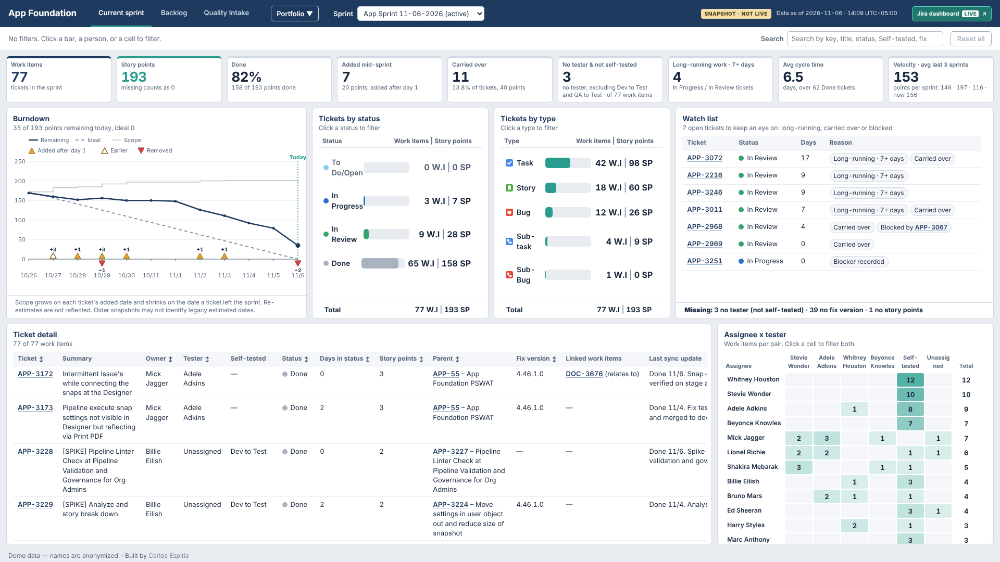
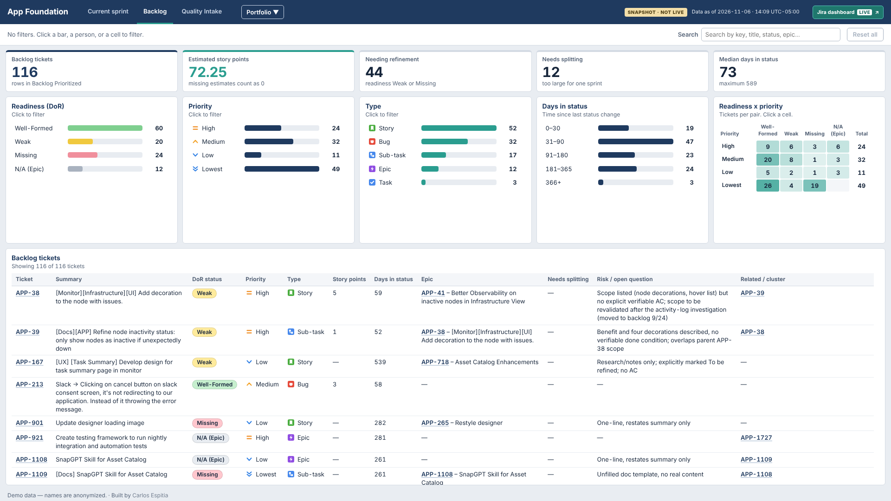
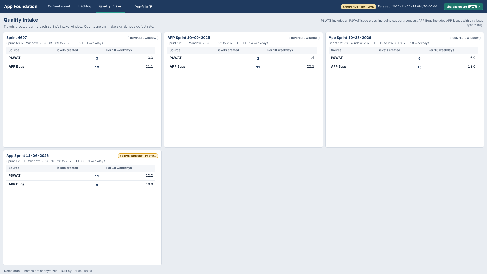
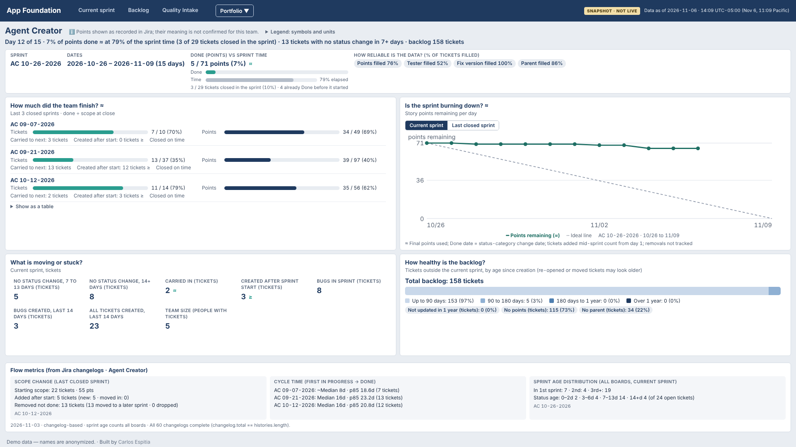

# Sprint Dashboard: an AI-built Scrum dashboard, driven by a written spec

A static, zero-dependency dashboard for a Scrum team: current and closed sprints, backlog readiness, quality intake and a multi-team portfolio view. I built it as a Scrum Master to replace manual sprint reporting, by writing the product and data rules myself and directing AI coding agents to implement and test them.

> **Demo data.** This repository is a showcase copy of a dashboard used by a real software team. People's names are replaced with famous singers; ticket keys, dates and counts are kept close to the real ones so the views behave as they did in use.

**Live demo:** https://javierespitia83.github.io/sprint-dashboard-demo/



## The problem

As Scrum Master, the information needed for the daily standup, sprint review and backlog refinement was spread across Jira, a team tracker spreadsheet and meeting notes. Preparing each ceremony meant rebuilding the same picture by hand: what is done, what is stuck, who is testing what, which backlog items are ready to plan.

## What it does

| Page | What it answers |
|---|---|
| **Current sprint** (`index.html`) | Is the sprint on track? Eight KPIs, burndown, tickets by status and type, a watch list of long-running, carried-over or blocked work, assignee x tester coverage. Every chart cross-filters the rest of the page. Closed sprints can be reopened from a selector. |
| **Backlog** (`backlog.html`) | Which items meet the Definition of Ready, which are weak or missing, by priority and age in status. |
| **Quality intake** (`quality-intake.html`) | How many support escalations and bugs were created in each sprint window, with rates per 10 working days. |
| **Portfolio** (`portfolio.html`) | One view across several teams' Jira projects. |

| Backlog | Quality intake | Portfolio |
|---|---|---|
|  |  |  |

## How I worked: spec first, agents second

The interesting part of this project is less the code than the way it was built.

- **Spec-driven.** Before any code, I wrote what to build ([`SPEC.md`](docs/spec/SPEC.md)), what the data means and how every number is calculated ([`DATA_CONTRACT.md`](docs/spec/DATA_CONTRACT.md)) and what "done" means ([`ACCEPTANCE.md`](docs/spec/ACCEPTANCE.md)). A precedence rule says which document wins when they disagree.
- **Decisions are logged.** [`DECISIONS.md`](docs/DECISIONS.md) holds roughly 100 numbered decisions and open questions, each with the date, who confirmed it and which spec section it changed.
- **"Done" is executable.** An acceptance harness ([`tests/acceptance/`](tests/acceptance)) drives the pages in headless Chrome and runs about 600 checks on layout, filters, numbers and safety rules; 31 unit tests cover the pure functions and the schema validator. The harness, not the agent, decides when a change is finished.
- **Rules for agents.** [`AGENTS.md`](AGENTS.md) tells any AI coding agent what it may and may not do: read order, files it must not edit, when to stop and ask.
- **Reproducible with another AI.** Appendix B of [`IMPLEMENTATION.md`](docs/IMPLEMENTATION.md) is a prompt that lets a different agent rebuild the whole app in an empty folder from the documents alone, with the acceptance harness as the judge.

## Where the data comes from

```
Jira ──(Atlassian MCP connector, read-only)──► team tracker (Excel) ──► exporter (Python) ──► JSON snapshots ──► static pages
```

The pages never call Jira or read Excel: they load JSON from `data/`, validated against `schema/`. The surrounding workflow runs as AI agent skills that I designed: syncing the tracker from Jira, turning meeting transcripts into minutes and tracker notes, exporting the snapshots and publishing them through a pull request that is merged only after my confirmation. A human reviews every write that leaves the machine.

## Technical choices

- Plain HTML, CSS and JavaScript: no framework, no build step, no dependencies, no CDN or web fonts.
- Works offline once the JSON exists; strict Content Security Policy, no network APIs.
- JSON Schema (2020-12) for every data file, with fixtures for edge cases.
- Designed for a 1920 x 1080 screen in ceremonies, usable down to 1366 x 760.

## Results

- Used in daily standups, sprint reviews and backlog refinement for a real team across several sprints (September to November 2026).
- Made project follow-up much faster. Jira holds all the data but is hard to tailor; here everything I needed as Scrum Master was in one view.
- Put risks on the radar early: long-running, carried-over and blocked work stands out at a glance, before it turns into a missed commitment.
- Showed the team's performance in a single look, which I used to steer the ceremonies, for example spending the daily on blockers or on work that was starting to stall.

## Run it

```bash
git clone https://github.com/javierespitia83/sprint-dashboard-demo.git
cd sprint-dashboard-demo
python3 -m http.server 8000      # then open http://localhost:8000/
```

`file://` is not supported because browsers block `fetch()` of local JSON. Tests: `node --test tests/unit.test.js` (Node 22+); the full acceptance run is `node tests/acceptance/run_acceptance.js` and needs Google Chrome (`CHROME_PATH`).

## Repository layout

```
├── index.html, backlog.html, quality-intake.html, portfolio.html   the four pages
├── assets/css, assets/js        styles and page scripts (no build step)
├── data/                        sprint manifest, sprint snapshots, backlog, quality intake, portfolio
├── schema/                      JSON Schemas for every data file
├── tests/                       unit tests, acceptance harness (tests/acceptance/), fixtures
├── tools/build_portfolio.py     rebuilds data/portfolio/ from saved Jira query results
├── docs/spec/                   SPEC, DATA_CONTRACT, ACCEPTANCE
├── docs/                        DECISIONS, IMPLEMENTATION, OPERATIONS, screenshots
└── AGENTS.md                    rules for AI coding agents
```

## Documents

| File | What it covers |
|---|---|
| [`docs/spec/SPEC.md`](docs/spec/SPEC.md) | The product: pages, metrics, interactions, design |
| [`docs/spec/DATA_CONTRACT.md`](docs/spec/DATA_CONTRACT.md) | Field rules, null handling, calculations |
| [`docs/spec/ACCEPTANCE.md`](docs/spec/ACCEPTANCE.md) | Definition of done and the checks |
| [`docs/DECISIONS.md`](docs/DECISIONS.md) | Why things are the way they are |
| [`docs/IMPLEMENTATION.md`](docs/IMPLEMENTATION.md) | How the code is organized, the build plan and the rebuild prompt |
| [`AGENTS.md`](AGENTS.md) | Rules for AI coding agents |
| [`docs/OPERATIONS.md`](docs/OPERATIONS.md) | Refreshing the data from the real tracker (original deployment) |
| [`docs/PORTFOLIO_REFRESH.md`](docs/PORTFOLIO_REFRESH.md) | Refreshing the portfolio view from Jira |

## License

MIT. See [`LICENSE`](LICENSE).

## About me

Carlos Espitia, Scrum Master / Technical Program Manager working on how AI agents can take over the repetitive parts of agile delivery. [LinkedIn](https://www.linkedin.com/in/javierespitia/)
